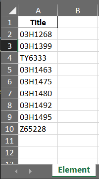
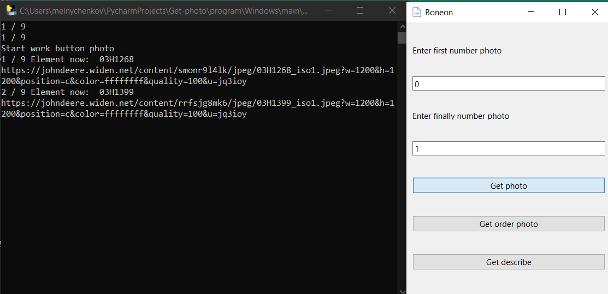
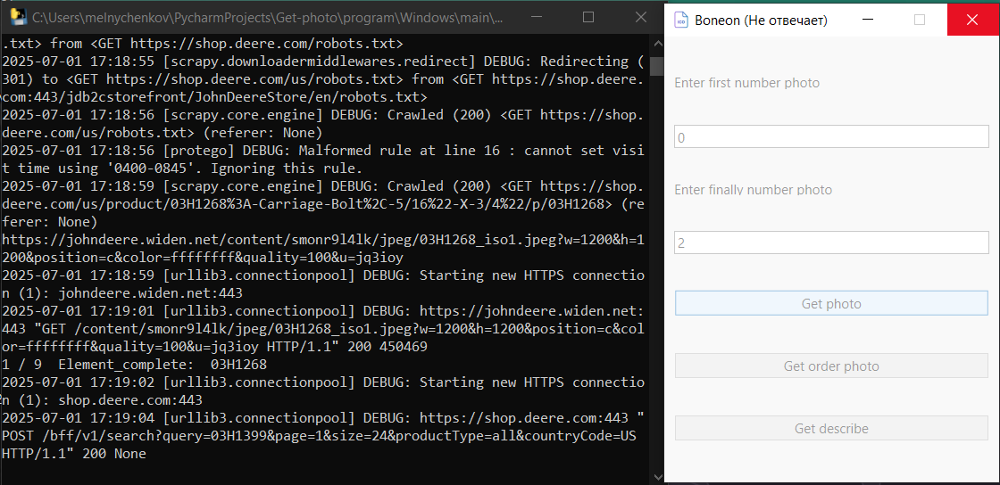
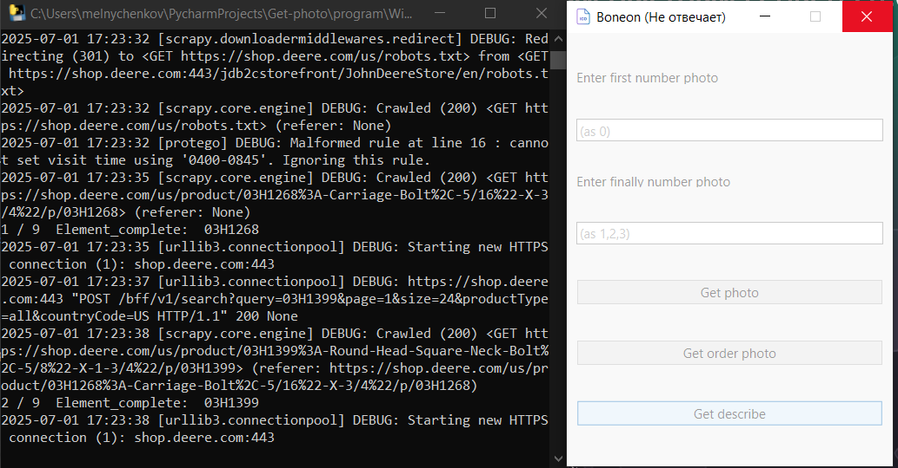

# Project "Boneon"
-----
### For using project need
- VPN on all system(not Opera VPN)
- Windows(have Linux, but don't update function)
[URL to linux project](https://github.com/bontonent/Upgate_get_photo/tree/master/script_get/dist/main)
- 100MB on program and memory on file: .xlsx, .jpg
- Internet +-1 MB on second(if very low, can be crash)

### For using need "art_photo.xlsx"
#### in art_photo.xlsx
- Need sheet_name "Element"
- In "Element" first column for "Article" without "DD "
  (Remember first row without an Article, you maybe create title for column)
- All file art_photo.xlsx remove all data what don't need for work.
### Example
---

After create file, We can using program
### Activate VPN
## Open main.exe
You get error if don't have "art_photo.xlsx","VPN"

## You have 2 field for write and 3 button
### If you want get photo
1 Write necessary in start field for write (for example 0)
2 Write in second field for write (for example 1)
Start get photo(photo in directory photo/.)
#### for example(0 1)

In left cmd you can see 1/9,2/9 It is count element complete
#### for example(0 2)

In left start load scrapy and same count
### if you want get pull photo xlsx
you need click button "Get order photo"
after click get pull_photo.xlsx

remember, if don't have photo in photo/. directory you don't get result
### If you want get describe
you need click button "Get describe"
after click you get describe.xlsx

you get describe.xlsx with all describe
# !!! Can be error
- if you click twith on "Get describe" or "Get photo", or click one on "Get describe" and "Get photo"
## Solution:
- you need close and open program
  (specific scrapy)
